# Linuxverse

An offline, installable web app (PWA) that teaches everything about Linux. Every topic has up to four tabs:

- **Explain**: plain-language concepts, key terms, comparison tables, example scripts and distro notes
- **Visual**: a step-by-step animated diagram with packets flowing between the parts
- **Commands**: real commands with descriptions, distro badges and a **Run** button that types out an animated result
- **Live**: an interactive lab that really computes, plus a replayed terminal session

Created by **SSK-BLUM**. The logo (Orbit prompt) is animated: a satellite circles the ring and the prompt cursor blinks. It follows the colour palette, and `icons/icon.svg` animates as the browser tab icon.

## Features

- **Theory first on Home**: one hundred core ideas in nine groups (Basics, Security, Programs, Files, Text, System, Network, Scripting, Tools), picked from a grouped drop-down menu. Each has the theory, key points and a common mistake. Each one is explained, then shown inside an example folder (`~/website`) you can tap through, then used with commands in a practice terminal. The folder updates live as you run commands like `chmod` or `touch`.
- **Learn by doing on every topic**: each topic's Explain tab has a "Try it now" block with three commands you can run in a practice shell that already contains `~/website`.
- **Progress**: mark topics as done, finished ideas and labs are ticked, and Home shows a progress card with a Continue button. Everything is stored in the browser only; "Reset my progress" is in the footer.
- **Quick jump**: animated buttons under the search bar that scroll smoothly to each section of the current page, and highlight where you are. A progress line under the header shows how far down you are.
- **Display mode**: a button before "?" cycles Auto, Mobile, Tablet and Web. Auto detects the screen size and touch input; the others force a layout with tuned spacing, touch targets and column widths.
- **Start here**: a 25-step beginner path mixing ideas, topics and labs.
- **Section quizzes**: four questions per section with an explanation after each answer. Three right passes, and your best score is kept.
- **Games**: six short study games (command match, permission puzzle, typing race, pipeline puzzle, command doctor, where am I) with best scores kept on the device. They are listed above the live labs.
- **Challenges**: fifty goals on the example folder (make a script executable, back up a file, count 404 errors with a pipe, and more). The app checks your work, with a hint and the answer if you are stuck.
- **Saved topics**: star a topic to find it again on Home and Learn. "Report a mistake" links open an email with the topic filled in.
- 12 sections, 100 topics, 710 documented commands, 32 animations, 18 live labs, 6 games, 100 ideas, 55 quiz questions, 50 challenges, 922 A–Z entries
- **Newer topics**: archives, finding commands and files, nano and vim, diff and patch, kernel modules, scp and rsync, nginx and reverse proxies, checksums and GPG, hardening, fail2ban, sudoers, TLS certificates, systemd units and timers, curl and wget, jq, sed and awk in depth, getopts and safe scripts, and a Dev tools section with git (branches, undo, remotes), Docker, Compose, tmux, Python venv and building from source
- **Simulated terminal** (Ubuntu flavour): virtual filesystem with permissions, `cd ls cat mkdir touch cp mv rm ln chmod stat tree`, `echo` with `>` and `>>`, pipes through `grep head tail wc sort uniq cut awk tr nl rev tee`, `&&` `||` `;`, variables and `$(...)`, `for`, `while read`, `case`, `[[ ]]`, scripts with `./file` and `bash file`, `sudo` and `sudo -i`/`exit`, background jobs, Tab completion and ↑/↓ history. Every documented command answers.
- **Live labs** (18): chmod calculator, umask explorer, directory-tree explorer, pipeline builder, grep playground, signal simulator, memory and load visualiser, cron decoder (with next run times), subnet calculator, a package-manager translator (apt, dnf, pacman, zypper), sed playground, find, tar and rsync command builders, date format builder, SSH tunnel builder, systemd unit generator and an `ls -l` decoder
- **"?" How-to-use guide**: every button and feature, grouped and searchable. Tap an entry and the app navigates there and spotlights it. **Quick view** at the top plays the whole guide one entry at a time, with Next, Prev and Stop.
- **A–Z of Linux**: a searchable dictionary of 900+ words and commands (absolute path to zsh) with letter index, runnable examples and links to the matching topics.
- **Ambience music**: ten soundscapes generated live with the Web Audio API (Kernel Hum, Midnight Rain, Deep Focus, Night Compile, Orbit Drift, Ocean Tide, Forest Night, Lo-fi Terminal, Coffee Shop, Aurora Pads), so there are no audio files and it works offline. Mini player with visualiser, play/pause, previous/next with crossfade, volume, track list and a minimise bubble.
- Search across topics, commands and labs; dark and light themes with six colour palettes (Amber, Ocean, Violet, Rose, Forest, Slate); mobile-first (tested at 390 × 844); fixed header and bottom navigation; no horizontal scrolling; respects reduced motion

## Screenshots

| Home | Animation | Commands | Terminal |
|---|---|---|---|
| 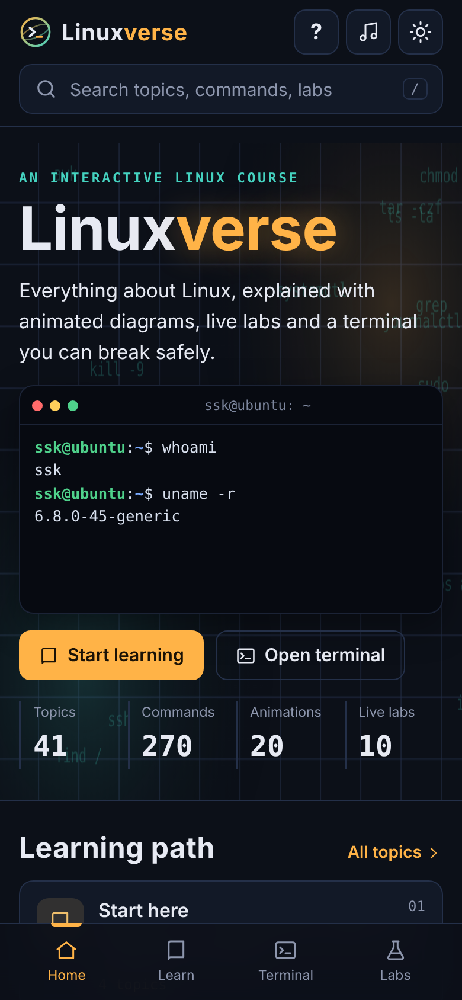 | 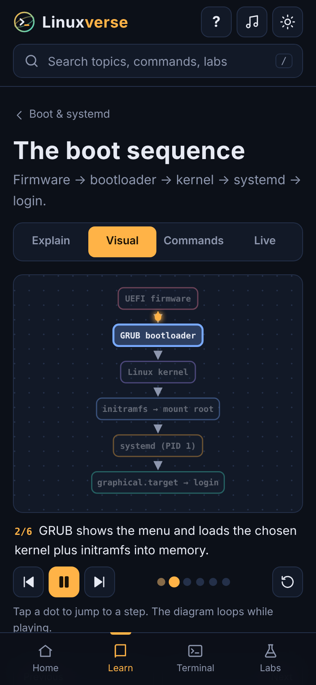 | 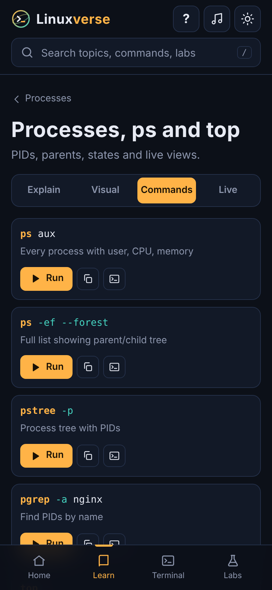 | 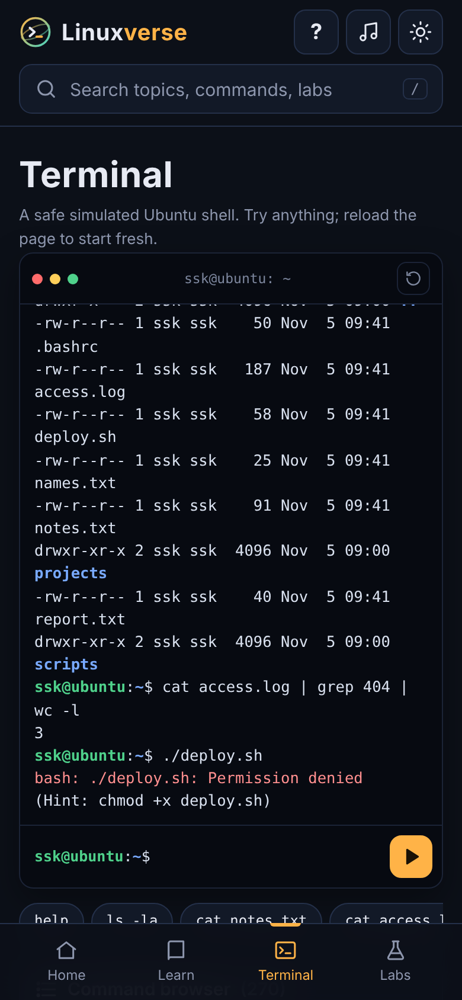 |

| Example folder | Pipeline lab | chmod lab (light) | How-to-use guide | Music player |
|---|---|---|---|---|
| 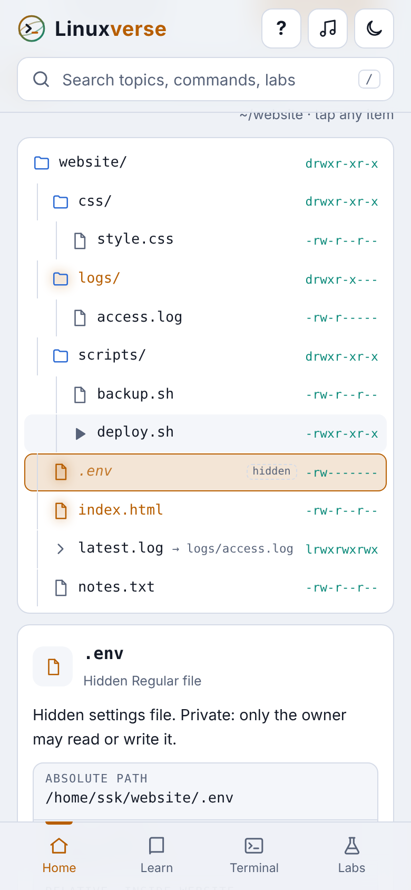 | 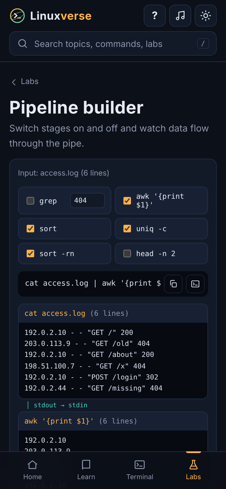 | 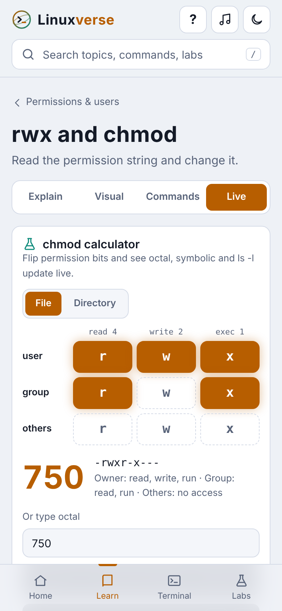 | 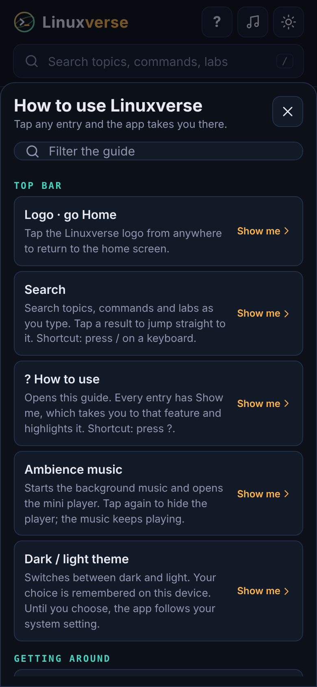 | 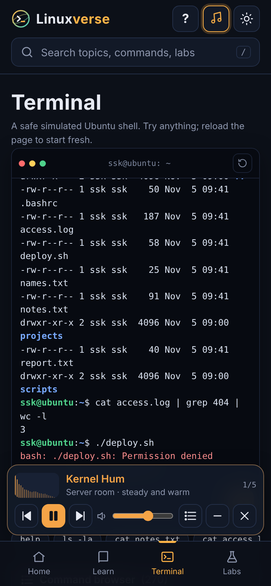 |

| Start here | Challenge | Quick jump | Games |
|---|---|---|---|
| 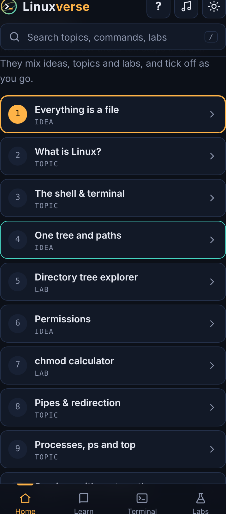 | 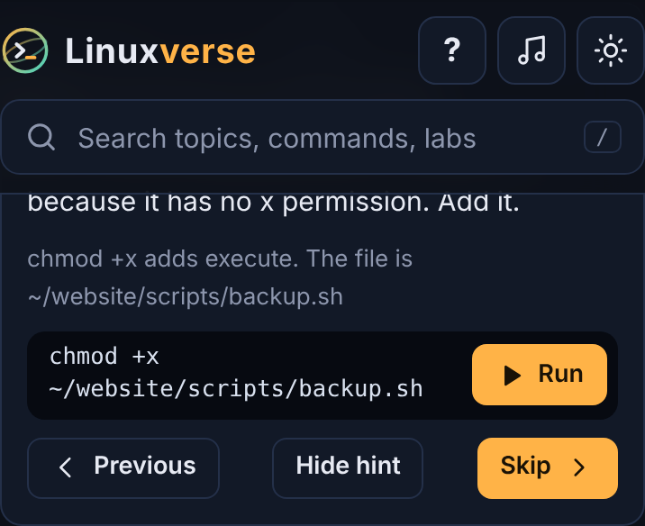 | 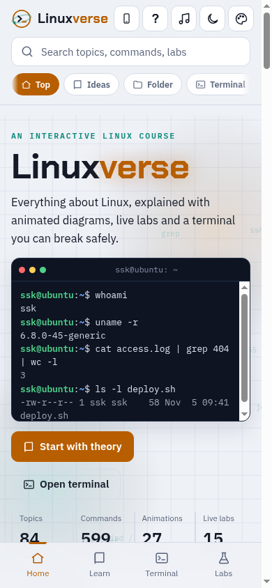 | 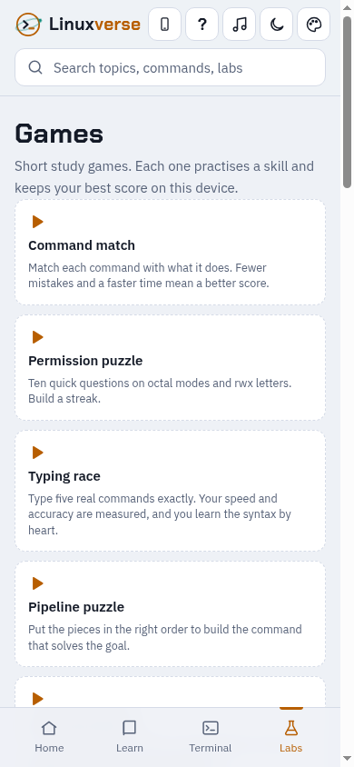 |

## Run locally

```bash
python3 -m http.server 8000
# open http://localhost:8000
```

Service workers need `http://localhost` or HTTPS. The single-file `dist/index.html` opens straight from disk (no offline cache in that mode).

## Build and release

```bash
# 1. bump VERSION in js/core.js
# 2. build
python3 build.py
```

`build.py` regenerates `sw.js` (cache name `linuxverse-v{VERSION}`) and writes to `dist/`:

- `linuxverse.zip`: the full PWA
- `index.html`: a single-file preview with all CSS and JS inlined (service worker registration is skipped)
- `artifact.html`: the same preview without the document skeleton, for hosts that wrap pages

## Deploy (GitHub Pages)

Push to `main`. `.github/workflows/pages.yml` builds and publishes the site. In the repository settings, set **Pages → Source** to **GitHub Actions**. All paths are relative, so it works from a sub-path such as `/linuxverse/`.

## Project structure

```
index.html              app shell
manifest.webmanifest    PWA manifest
sw.js                   generated service worker
css/app.css             design tokens and styles (dark + light)
js/core.js              VERSION, registry (LV.sec, LV.add, LV.tool), storage, icons
js/data/*.js            content, a few sections per file (01-07 core, 08-11 extra topics)
js/anim.js              animated diagram engine
js/labs.js              live labs
js/labs2.js             more live labs (sed, find, tar, date, tunnels, units, ls -l, rsync)
js/games.js              six study games
js/term.js              simulated shell and terminal UI
js/learn.js             progress, bookmarks, start-here path, section quizzes
js/explore.js           Home walkthrough: theory → example folder → use it → challenges
js/ideas2.js             74 more ideas for the walkthrough
js/challenges2.js        38 more challenges
js/ambience.js          generative music engine and mini player
js/help.js              "?" guide with jump-to spotlight
js/app.js               router, views, search, theme, display mode, quick jump
icons/                  SVG + PNG icons (192, 512, maskable 512, apple-touch)
build.py                build script
```

## Adding content

```js
LV.sec({ id: 'mysec', title: 'My section', icon: 'book', hue: 200, desc: '…', topics: [ /* topics */ ] });
LV.add('net', [ /* more topics for an existing section */ ]);
LV.tool({ nmap: { syntax: 'nmap [options] target', desc: 'Network scanner.' } });
```

A topic:

```js
{
  id: 'chmod', title: 'rwx and chmod', sum: 'One-line summary',
  explain: ['Paragraph (HTML allowed)'],
  terms: [['Term', 'Definition']],
  table: { head: ['A', 'B'], rows: [['1', '2']] },
  code: 'example script',
  anim: { nodes: [['id', x, y, 'Label', 'user|proc|kernel|file|hw']], edges: [['a', 'b']], hide: ['id'],
          steps: [{ t: 'Caption', hi: ['id'], show: [], dim: [], flow: [['a', 'b']] }] },
  cmds: [['ls -l', 'What it does', 'optional simulated output', 'optional distro badge']],  // one command per row
  flags: [['-l', 'Meaning', 'tool']],
  live: 'chmod',            // optional lab id from js/labs.js
  demo: ['ls -l', 'chmod 750 deploy.sh'],
  tips: [], warn: [], note: 'distro differences'
}
```

Use placeholder values only: `example.com`, documentation IP ranges (192.0.2.x, 198.51.100.x, 203.0.113.x), user `ssk`. Do not add commands or flags you have not checked against the real man page.

## Credits

Created by SSK-BLUM · soorajsknairqa@gmail.com

## Disclaimer

Simulated output: nothing runs on your device. Linux® is the registered trademark of Linus Torvalds. Ubuntu, Debian, Fedora, Red Hat, Arch Linux and openSUSE are trademarks of their respective owners. This is an unofficial learning reference.

## Contributing

Issues and pull requests are welcome. Keep content accurate and beginner-friendly, run `python3 build.py` before you commit (it regenerates `sw.js`), and bump `VERSION` in `js/core.js` for any user-visible change so the offline cache refreshes.
